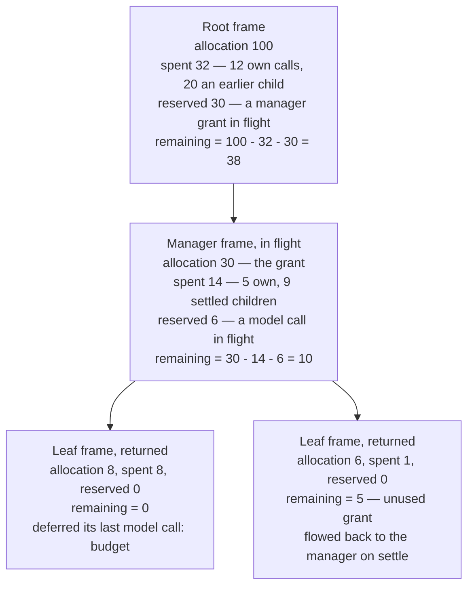
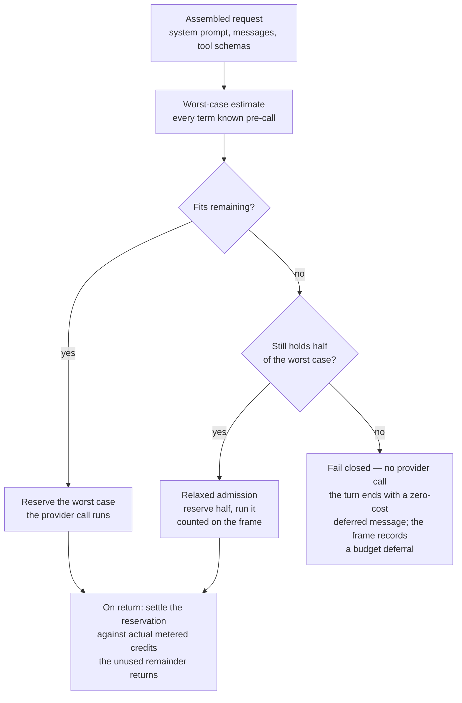
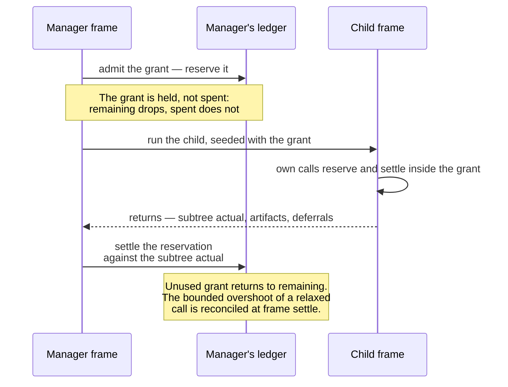
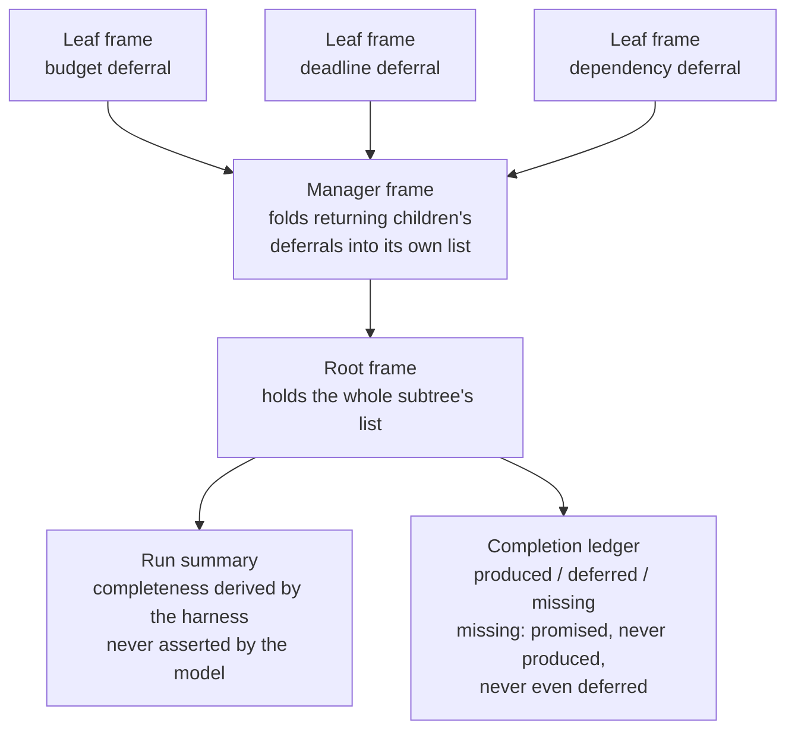

*2026-10-21 · mechanism documentation · mechanisms as shipped, evaluation pending*

An agent that delegates is a tree of spending commitments. The root agent's
plan is not a list of to-dos — it is a promise that somewhere down the
reporting structure, someone can pay for the work. Mainstream cost control
mostly observes that promise after the fact: the calls happen, tokens are
counted, a dashboard reports what was spent. Accounting, not control.

When a run goes wrong, the two failure modes are symmetric:

- **Overspend.** A branch of the tree commits to work it cannot fund, and the
  run finds out on the invoice — or worse, mid-flight, when a spending cap
  kills the deepest branch and the work above it is wasted.
- **Silent truncation.** Something stops the work, and the run "finishes"
  anyway. The deliverable is missing, nothing records why, and the summary
  reads as though the plan succeeded.

desalpage is built around the opposite discipline, borrowed from networking:
**admission control**. Every model call is priced at its worst case *before
the provider is reached*, reserved against a balance that spans the whole
delegation tree, and settled against actual spend when it returns. A call
that cannot be funded never runs — and the refusal is not an error but data:
a typed, auditable deferral that flows to the same place as the results.

This post describes the two mechanisms at the center of that discipline as
they are shipped today: pre-call admission control over a recursive budget
tree, and deferral as a designed outcome. It describes mechanisms, not
measurements — the honesty discipline behind that choice comes at the end.

## One invariant, everywhere

Every invocation in a run is a **frame**: the root's turn, or a
delegated child's turn. Frames form a tree, and each frame carries a
**budget** — four numbers:

```text
allocation   the credits the frame was seeded with
spent        actual spend of the whole subtree so far
reserved     held for in-flight calls and open child grants
remaining    allocation - spent - reserved >= 0
```

The invariant is enforced at every admission, everywhere in the tree: a frame
can never commit credits it does not hold. The distinction between `spent`
and `reserved` is what makes the balance honest while work is in flight —
`reserved` is money promised but not yet spent, and it is subtracted too, so
the same credits cannot be committed twice.

A credit is an abstract, provider-neutral unit of spend — a single
non-negative number. Fixed meter weights turn the provider's reported token
usage into credits, so the whole tree reasons about one currency while the
meter absorbs provider pricing.

The root frame is seeded with the sprint's allocation; a delegation seeds
its child's frame with the granted amount. A frame's own model calls and the
grants it hands down draw from the same `remaining`, which buys an important
property for free: a manager cannot allocate its entire budget away and
still keep running itself.



One mid-run snapshot of one branch. Every node maintains the same invariant;
a parent's reservation for a child in flight is the whole grant, and it
settles to the child's actual subtree spend when the child returns.

## Price the call before it exists

Before each in-process model call, the runtime computes a worst-case charge:

```text
maxCall = base
        + input-weight    * contextTokens
        + output-weight   * maxTokens
        + reasoning-weight * reasoningBudget
```

Every term is known before the call: the context is estimated from the
assembled request (character count over a conservative tokens-per-character
ratio — over-estimating is the safe direction), output is assumed to run to
the model's declared cap, reasoning to its effort-level share of that cap.
No tokenizer, no model call, fully deterministic.

Then the admission decision, strict first, with one bounded relaxation:

- If `maxCall` fits in `remaining`, the frame **reserves** it and the call
  runs.
- If it does not fit but the frame still holds half of it, the admission is
  **relaxed**: the call runs, reserved at half — and the frame counts that
  it did, so a run that leaned on the relaxation is observable rather than
  indistinguishable from one that never approached its bound.
- Below that, admission **fails closed**: the turn ends without reaching the
  provider. The refusal is a synthesized message that costs nothing — zero
  usage by construction — and the frame records a `budget` deferral.

The relaxation exists because the worst case is deliberately pessimistic: a
frame with a real balance left keeps working instead of starving on its own
conservatism. It is not a one-time allowance: every admission decision is
made the same way, and a frame may use the relaxation more than once while
its balance still holds half of the estimate — each use counted. A relaxed
call can settle above what it reserved by at most the unreserved half of its
own estimate, and the shortfall is reconciled when the frame settles.

Delegations are priced the same way, one level up. A grant must meet a
floor declared for each type of task — and the floor is only ever *raised*,
never undercut, by the harness's own settled spend history, once at least
three settled attempts of that task support it (self-calibrating pricing
deserves its own post). A grant below the floor underfunds the child; a
grant more than ten times the floor is a guess, not a plan. Both are
refused — and so is a grant that does not fit the manager's `remaining`. A
delegation that cannot fund its own worst case is refused up front, never
discovered on the invoice.



## Settle on return

A reservation is a hold, not a spend. When the call returns, the
reservation **settles** against the metered actual: the hold is released,
the actual is charged, and the unused remainder returns to the balance. A
call that estimated 8 and metered 3 gives 5 back.

Delegations settle the same way, on a slower clock. The manager reserves the
whole grant against its own balance before the child starts; the child frame
runs *inside* that grant, its own calls reserving and settling within it;
and when the child returns — normally, crashed, or aborted — the manager's
reservation settles to the child's actual subtree spend. The unused part of
the grant flows back to the manager.

Because every settle reconciles actuals, the tree's books are exact at the
end of the run even where a frame leaned on the relaxed admission: a
frame-settle pass tops up the one bounded shortfall, so the totals balance.



## Unfinished work is an outcome

The other half of the discipline concerns work that does not finish. In
most systems an unfinished branch is an error, a timeout, or — worst —
nothing at all. Here it is a first-class result: a typed **deferral**,
recorded by the harness, never asserted by the model.

| Reason | Recorded when |
| --- | --- |
| `budget` | Admission control refused — a call or a delegation grant could not be funded. |
| `deadline` | The frame passed its wall-clock bound. |
| `no-progress` | The frame kept calling without observable progress, repeating calls it had already made. |
| `blocked` | Work failed or its declared output never arrived — a child that crashed; a required report that did not land. |
| `capability` | The work needs a tool the agent's assignment does not carry. |
| `dependency` | A task queued on upstream artifacts that were never published before the frame closed. |

Deferrals aggregate: each frame records its own, and a returning child's
list folds into its parent's, so the root ends the run holding the whole
subtree's unfinished work in one place. From there the record is used, not
filed away:

- Every frame's **completeness** — `full`, `partial`, or `deferred` — is
  derived by the harness from artifacts and deferrals. The model never
  grades its own work.
- At run end, the plan's promised deliverables are crossed with what was
  produced and what was deferred, into a **completion ledger** with three
  states: `produced`, `deferred`, and `missing`. `missing` is deliberately
  the worst state on the ledger — a promise that was neither produced nor
  deferred, meaning nothing in the run even recorded failing it. Naming it
  is how it gets noticed.
- A `budget` deferral carries provenance — which agent, which artifact,
  roughly how many credits — and becomes an actionable feedback to adjust
  the next run's configuration. The refusal is the input for governance.



## What this costs

What the mechanisms buy is a pair of guarantees:

1. **The tree cannot commit money it does not hold.** The invariant is
   checked at every admission, and the only path that can settle above a
   frame's allocation is the bounded, counted relaxation — never the
   invoice.
2. **The run cannot end silently.** Every unfinished thing is typed,
   aggregated, and accounted — or, if the plan promised it and nothing even
   recorded failing it, named `missing` on the ledger.

The price is real, and it is paid deliberately. A held reserve is capacity a
frame cannot spend elsewhere while the hold stands. Worst-case estimates are
conservative by construction, so frames refuse calls they often could have
afforded — the soft fraction is the pressure valve, not the rule. Throughput
is traded away to buy the two guarantees above, and that trade is a design
decision; this post does not pretend to have measured its cost. The
evaluation that would put numbers on it — budgeted against unbudgeted runs
at matched credit — has not run. When it does, a preprint will follow, and
the numbers will be linked from here. Until then: mechanisms as shipped,
claims deferred — which is, not coincidentally, how the system itself
answers unfinished work.

One boundary deserves plain words. The pre-call reservation covers what the
runtime can price before the call: its own in-process model calls and
delegation grants. Commands that run out-of-process in a sandbox cannot be
pre-priced; they are bounded by wall-clock time and the frame's remaining
time instead, and their reported usage is charged to the frame on return, so
subtree spend still rolls up. The guarantee is stated for what it covers —
not more.

## The descent is planned

*Desalpage* is the Alpine transhumance term for the planned descent of the
herds when the high-pasture season ends: a bounded season, and an ending
that is deliberate, complete, and never silent. The name and the mechanism
are the same idea. The reservation discipline bounds the season; the
deferral algebra makes the ending deliberate, complete, and never silent.
When the herds come down, every one is counted — and the ones that stayed
on the high pasture are on a list, with a reason.

A second post is in drafting: a case study of a run whose accounting
machinery worked exactly as designed — and what it discovered about the plan
surface it was reporting on. Code artifacts will appear in this repository
as they are released, each extracted with provenance. If you want the next
post when it lands, the [RSS feed](../../rss.xml) is live.

## How to cite

The desalpage Authors. "Reserve before you call." 2026-10-21.
`https://desalpage.github.io/desalpage/blog/2026-10-21-reserve-before-you-call/`

---

*This post, like all prose on this site, was drafted by an AI agent under
human direction and reviewed before publication — see
[About](../../about/).*