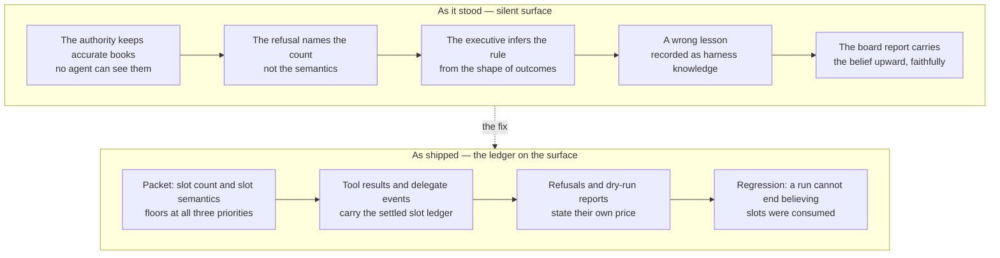

*2026-10-22 · incident case study · mechanisms as shipped, evaluation pending*

desalpage is developed against a reference consumer: a simulated game
studio, a company of agents that ships game prototypes sprint by sprint
under the governance machinery that is the actual system under
development. The company is simulated; the machinery is not staged for
the occasion — and a *live* run means live models and metered spend: real
delegations, real refusals, a real ledger.

Every run ends the same way: the CEO writes a board report — what shipped,
what was deferred and why, and what the company asks of the board, which
is a human operator's desk.

One live run closed with a board report that mis-accounted its own
spending rules — confidently, in writing, as harness lessons, escalated
as a structure ask. It is among the most useful artifacts the system has
produced, and this post is about why: every piece of the governance worked
exactly as designed, and what it delivered to the operator was folklore.

## A run, and its report

The run was sprint 1 of a photosynthesis puzzle — a small single-screen
game about running a leaf's light and water budgets. Six must-priority
deliverables were delegated and shipped in strict order — brief, science
model, game-design document, a playable prototype, and two reviews — and
the accuracy review recorded zero falsehoods.

One acceptance criterion ended partial: the producer's fresh playability
re-review could not be re-issued, because the delegation cap refused it:

```text
Delegation refused: ceo already ran 8 of at most 8 children
```

Breadth is the structural cap on delegation: a frame — one delegated call
— may issue at most a fixed number of children, a bound independent of
the economic budget, so a broad manager cannot fork-bomb inside its
edges. The CEO's frame was capped at eight, and by the CEO's accounting
those eight slots had been "consumed by validate-executions, refusals,
and two sandbox-blocked engineer attempts" — bookkeeping artifacts
crowding out a must-priority review. The report recorded two harness
lessons for planning: that `validate:true` "is not side-effect-free: it
executed two children," and that "refusals and failed sandboxes consume
breadth." And it escalated a structure ask: make breadth accounting
transparent to the executive frame, so must-priority reviews can never be
crowded out again.

Worth pausing on what went right, because it is most of the story. The
refusal was enforced, not negotiated. The CEO did not route around the
authority informally; it disclosed the stale review rather than dressing
it up; it scheduled the re-review as the next iteration's first priority;
and it escalated the fix as a typed ask on the operator's desk. Every
governance mechanism in the chain held. Then the operator did the one
thing the report could not do for itself, and checked its claims.

## We checked the books

The harness had kept an allocation ledger the whole time — every
delegation attempt opens a row, a refusal records its reason on the row,
a granted attempt settles its actual spend. The books were accurate. The
question was what the enforcement says takes a slot, so we read the
delegation tool, at the state of the code the run used. Its rules:

- Only an **issued child** takes a slot.
- A **refused** delegation takes no slot and no budget; the refusal lands
  on the row, and nothing else.
- A **queued** task takes nothing: it has not run, and a wait must not
  consume the slot that the work it waits on would need.
- A **`validate` dry-run** runs every preflight check and reports all
  findings at once — and "spends nothing: no budget, no delegation slot,
  no queue entry, and no child."

Under those rules, the eight slots had gone to issued children: the
deliverables that shipped — including the two the executive attributed to
`validate:true` — plus the two engineer attempts that blocked on sandbox
authentication and, under the rules as they then stood, kept their slots.
The dry-runs had executed no children. The refusals — including the
below-floor budget refusals the executive counted — had consumed nothing.
Both harness lessons were wrong about the books.

Nobody lied, and nothing was invented. The report carried the executive's
beliefs faithfully
upward; that is its job, and it did it. The beliefs were wrong because
nothing the executive could see stated the ledger: the plan surface was
silent, the refusal message named a count but not the semantics, and an
agent planning against an unwritten rule infers the rule from the shape
of its outcomes. Honesty is not accuracy. A reporting channel that
cannot distort will faithfully transport a wrong model of the rules — and
a wrong model recorded as lessons for planning becomes the priors of the
next sprint.

## How folklore forms

An agent cannot read the harness it runs under. What it can observe is
the plan surface: the turn packet it plans against, the tool results that
come back, the refusal messages that stop it. When the surface is silent
about a rule, the rule does not disappear — it gets inferred. "The cap
refused me shortly after I ran dry-runs and refusals" is an observation;
"therefore dry-runs and refusals consume slots" is folklore wearing the
confidence of data.

Neither of the nearest words fits. Not fabrication: nothing in the
account was made up — the dry-runs ran, the refusals happened, and the
two children the report attributed to `validate` were real issued
children, mis-attributed rather than imagined. Not confabulation: the
events were observed, not patched in from nothing; what was missing was
the written rule that would have priced them. Folklore, as meant here,
is unwritten knowledge — a rule inferred from the shape of real
outcomes and passed on as lessons. Human folklore is often valuable,
hard-won knowledge a community never wrote down; this folk accounting
was wrong for a narrower reason: accurate books existed the whole
time and were simply not published.

Two agents in the same run can keep two different
sets of books in their heads, and neither will match the one the
authority enforces.

The same run had already produced the economic twin of the incident. The
turn packet's delegation-budget block at the time listed each delegate's
floor at a single priority — `should`. But the authority prices a grant
against the task's *declared* priority, so a must-priority delegation
planned from the `should` number asked 120 against a floor of 180 and was
refused. The floors were then discovered by refusal — the expensive way
to publish a number. Same drift, different
ledger: the enforcement knew a fact the surface did not print.



## Publish the books

The fix was not to explain the rules to the executive. A silent surface
cannot be prompted away: the next model, the next run, the next company
would re-derive its own folklore. The fix was to publish the books where
the agents plan:

- The turn packet's **Delegation budget** block prints the slot count the
  authority checks — `Delegation slots: 3 of 8 used.` — beside each
  delegate's floor at all three priorities and the artifacts the access
  policy will actually let them write.
- The packet's **Operational policy** block states the semantics in one
  line: "Slot semantics: only an issued child takes a slot — refused,
  queued, and `validate` calls take none, and a child that crashes without
  producing any output refunds its slot."
- Every `delegate` tool result carries the settled ledger —
  `Delegation slots: 4 of 8 used.` — and a refunded crash says so, with
  its reason: `Delegation slot refunded: engineer crashed without producing
  output (3 of 8 slots used).` The delegation events carry the same
  numbers as structured fields, so the ledger rides the record: an
  executive auditing its own run after the fact is reading, not
  reconstructing.
- The dry-run report states its own price: "This dry-run spends nothing:
  no budget, no delegation slot, no queue entry, and no child."

One rule was changed rather than merely published. A child that crashes
without producing any output now refunds its slot: an infrastructure
failure — a sandbox authentication block, a dead provider — is noise, not
breadth. A child that ran to completion keeps its slot even if it
produced nothing, because it consumed a real attempt, and the per-task
rework allowance still bounds re-issuing the same task, so a repeatedly
crashing child cannot loop for free. The incident's two blocked engineer
attempts are the case that decided it.

And the fix carries an acceptance test stated as a scenario: a manager
that runs refusals and `validate` calls cannot end the run believing
slots were consumed. The regression test that closes the scenario keeps a
one-line comment naming what it is for — the live CEO believed otherwise.
The measure of the fix is not smarter executives. It is that the wrong
ledger is no longer representable from the surface.

## The surface is the contract

This is the general lesson the incident paid for, and it is one of the
claims desalpage exists to make: **plan-surface/enforcement alignment**.
Governance over agents has two halves — the authority, which enforces,
and the plan surface, which is everything an agent can read while
planning. A rule that lives only in the authority's code will be learned
by folklore, and the folk books are wrong in both directions: they
charge events that cost nothing, and they write off events that cost
real slots. So the
surface must publish the same floors, priorities, writable paths, and
slot ledgers the authority enforces, and refusal messages must name the
rule that would change them — the typed budget refusal carries the floor;
the typed breadth refusal carries the count; the dry-run report carries
its own price. Enforcement without publication breeds superstition;
publication without enforcement is decoration. Alignment is what makes
either one governance.

The incident also has an operator's half. A governance report is honest
about beliefs, not necessarily right about facts — different guarantees,
and the first is what makes the second checkable. When the board report
arrived carrying a confident model of the harness's rules, the response
was neither to believe it nor to dismiss it, but to verify the model
against the code the run used. The structure ask turned out to be wrong
in its facts and right in its request: transparent slot accounting is
exactly what the executive should have asked for, and it is what shipped.
We publish the incident for the same reason the report published its
lessons: a wrong belief surfaced by the machinery is a finding, not an
embarrassment to hide. The honesty discipline binds the operator too.

## The count must be shared

The first post ended with the name: desalpage, the planned descent of the
herds when the high-pasture season ends — a bounded season, and an ending
that is deliberate, complete, and never silent. Every animal counted, and
the ones that stayed on the high pasture on a list, with a reason. This
post is about who gets to know the count. A ledger only governs if it is
the same ledger in every head that plans against it; when the books are
kept but not published, each head keeps its own, and the report at the
end faithfully carries whichever one it inferred. The fix is small and
unglamorous and permanent: the authority keeps the books, and the surface
prints them.

This is the case study the first post promised. Code artifacts will
appear in this repository as they are released, each extracted with
provenance. If you want the next one when it lands, the
[RSS feed](../../rss.xml) is live.

## How to cite

The desalpage Authors. "When the CEO learned our bookkeeping by
folklore." 2026-10-22.
`https://desalpage.github.io/desalpage/blog/2026-10-22-when-the-ceo-learned-our-bookkeeping-by-folklore/`

---

*This post, like all prose on this site, was drafted by an AI agent under
human direction and reviewed before publication — see
[About](../../about/).*